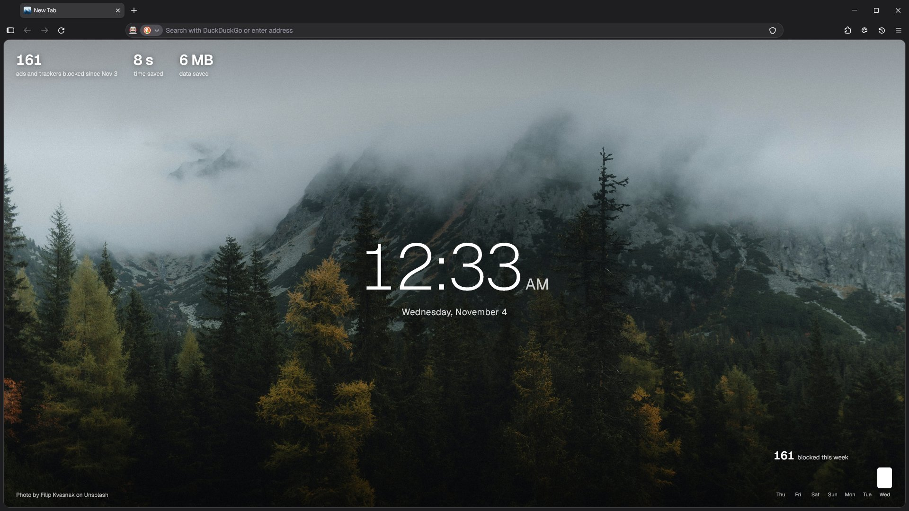
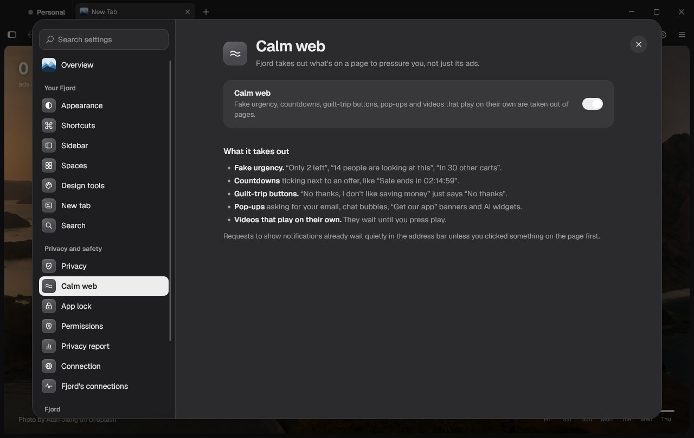
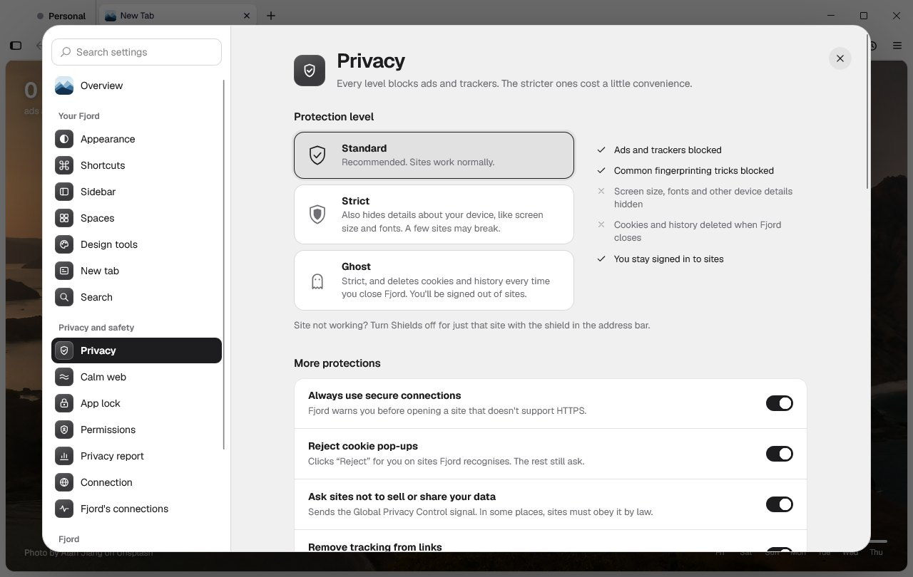
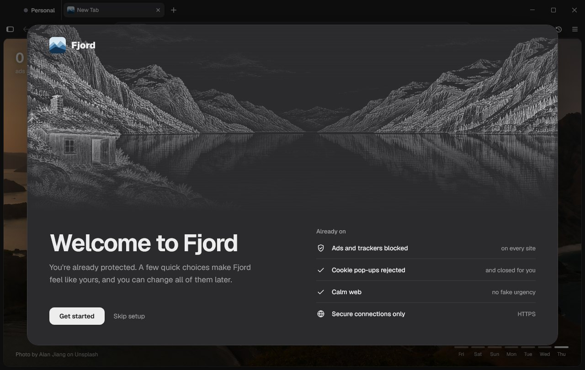

<p align="center">
  
</p>

<h1 align="center">Fjord</h1>

<p align="center">
  <b>A private browser built on Firefox.</b><br>
  Ads, trackers and the tricks pages use to rush you are gone from the first page you open.<br>
  No account, no telemetry, nothing about you collected.
</p>

<p align="center">
  <a href="https://github.com/Elias-Mathisen/fjord/releases/latest/download/Fjord.dmg"><b>Download for Mac</b></a>
  &nbsp;·&nbsp;
  <a href="https://github.com/Elias-Mathisen/fjord/releases/latest/download/FjordSetup.exe"><b>Download for Windows</b></a>
  &nbsp;·&nbsp;
  <a href="https://github.com/Elias-Mathisen/fjord/releases/latest"><b>Linux</b></a>
</p>

<p align="center">
  <a href="https://github.com/Elias-Mathisen/fjord/releases/latest"></a>
  <a href="LICENSE"></a>
</p>



Fjord isn't a fork: it's the official Firefox from Mozilla, set up with Firefox's own configuration files
(`Fjord.cfg`, `policies.json`) and a layer of window scripts and styles in `src/fjord/`. That's why it gets every
Firefox security fix the day it ships.

## Calm web

Blocking ads is where most private browsers stop. Fjord also takes out what a page uses to pressure you: fake
urgency ("Only 2 left", "14 people are looking at this"), countdowns next to offers, guilt-trip buttons ("No thanks,
I don't like saving money" just says "No thanks"), email and chat pop-ups, and videos that play on their own. It all
happens on your computer, and you can turn it off for one site in Shields.



## Private from the first page

- **Shields** in the address bar: a protection dial per site, which companies the page tried to share your visit
  with, and **Forget this site now**
- uBlock Origin built in, Firefox's strict tracker blocking, fingerprinting protection, HTTPS-only, Secure DNS (Quad9)
- **Randomised fingerprint**: made-up canvas, WebGL and audio readings, different for every site and every session
- **Ghost mode** (forget everything on close, with per-site exceptions) and **Mist tabs** (throwaway tabs)
- Warnings for **lookalike sites** (paypa1.com), **clipboard hijacking**, and sites using your camera, microphone or
  location
- **Skips tracking redirects** (google.com/url?q=…) and strips tracking codes from links
- **Private YouTube player**: YouTube's privacy-enhanced player, without recommendations or watch history
- **Privacy report**: week by week, which companies tried to track you and on which sites, counted on your computer
  and never sent anywhere
- **Fjord's connections**: a live list of every connection Fjord itself makes



## Yours in a minute

A short setup when you first open Fjord: bring over your bookmarks and passwords, pick light or dark and where your
tabs go, how strict to be and which search engine to use. Everything is already protected before you pick anything.



## And the rest

- **Sync** with your iPhone over the home Wi-Fi, and with your other devices through a folder you already have
  (iCloud Drive, Dropbox, a USB stick), sealed with the pairing's key. Computers also share passwords and settings.
  No account, no server
- **Spaces**: separate sets of tabs like Work and Personal, each with its own colour and sign-ins
- **Split view**, **tab folders**, a **command bar** (Ctrl+K) for tabs, bookmarks, history and Fjord's actions, and
  **link preview** (Shift-click)
- **App lock** with Windows Hello or Touch ID
- **Sidebar apps** (Spotify, WhatsApp…), **Memory saver**, and **design tools** (colour picker, font finder, asset
  saver, full-page screenshots)
- A new tab with 100 hand-picked Unsplash photos (or your own picture), reader view in Fjord's font, **Hide this** for
  cookie walls and pop-ups, and a ski jump game when you're offline

## Layout

| Path | What it is |
|---|---|
| `build.ps1` | Builds Fjord for Windows into `dist\` (downloads Firefox from Mozilla, checks its signature) |
| `tools/install.sh` | Installs and updates Fjord on a Mac or Linux (downloads Firefox from Mozilla, checks its signature) |
| `build-mac.sh` | Installs Fjord on a Mac from this checkout (`tools/install.sh` with `FJORD_SRC`) |
| `src/Fjord.cfg` | Firefox's autoconfig: Fjord's default settings, and loads everything below |
| `src/policies.json` | Firefox enterprise policies (uBlock Origin, tracking protection, no telemetry) |
| `src/fjord/browser.js` | Window script: new tab, setup, settings, sidebar apps, lookalike warning |
| `src/fjord/shields.js` | The Shields button and panel |
| `src/fjord/features/` | One script per feature (memory saver, Mist tabs, design tools, app lock…) |
| `src/fjord/*.sys.mjs` | Shared modules: privacy watch, uBlock bridge, permissions, Mist, app lock, sidebar apps |
| `src/fjord/page-frame.js` | Runs inside web pages: permission watch, clipboard guard, design tools |
| `src/fjord/chrome.css` | Fjord's look |
| `tools/installer/` | The Windows installer, updater and uninstaller (C#, built by `tools\build-installer.ps1`) |
| `tools/release.ps1` | Publishes a signed release on GitHub |
| `.github/workflows/build.yml` | Builds the installer on GitHub and has SignPath sign it (started by `tools\release.ps1`) |
| `tools/photos.txt` | The new-tab photos; `tools\get-photos.ps1` downloads them |
| `docs/` | The website (served by GitHub Pages) |

## Building

Windows (PowerShell):

```powershell
powershell -ExecutionPolicy Bypass -File tools\get-photos.ps1      # once: the new-tab photos
powershell -ExecutionPolicy Bypass -File tools\build-installer.ps1 # Fjord in dist\ and dist\FjordSetup.exe
```

Mac (quit Fjord first; it installs to /Applications):

```sh
sh build-mac.sh
```

Linux, from this checkout:

```sh
FJORD_SRC="$PWD" sh tools/install.sh
```

People download `Fjord.dmg` (Mac) or `Fjord-x86_64.AppImage` / `Fjord-aarch64.AppImage` (Linux on Intel and AMD, or
ARM, which installs Fjord the first time it's opened; `tools/appimage/`) from the latest release. Both keep Fjord up to date with `install.sh`, which also installs from a
terminal (`curl -fsSL https://github.com/Elias-Mathisen/fjord/releases/latest/download/install.sh | sh`, for ARM
Linux too) and removes Fjord with `sh ~/Library/Application\ Support/Fjord/updater/install.sh --uninstall` (Mac) or
`sh ~/.local/share/fjord/updater/install.sh --uninstall` (Linux).

## Releasing

Fjord's version is in `src/fjord/version.txt`. Raise it, add a few lines on what's new in that version to
`src/fjord/whatsnew.json` (Fjord shows them once after it updates, and they become the release notes), commit, then:

```powershell
powershell -ExecutionPolicy Bypass -File tools\release.ps1
```

That pushes, has GitHub build `FjordSetup.exe`, `Fjord.dmg`, both AppImages and the files Macs and Linux
update from (`fjord-files.tar.gz`) from the pushed code (`.github/workflows/build.yml`), where SignPath signs the
installer for Windows, then signs the installer and `fjord-files.tar.gz` with Fjord's release key on your PC and
publishes them all, with `install.sh`, as a GitHub release. Older releases become drafts, so only the newest can be
downloaded.
Installed copies check for it every 3 hours and only take an update signed with that key. The key is made once by
`tools\make-release-key.ps1`; its private half stays in `%APPDATA%\Fjord release\` and must be backed up.

Checks for the privacy rules can be pasted into Fjord's Browser Console (Ctrl+Shift+J): `tools/test-lookalike.js`,
`tools/test-redirects.js`.

## Code signing policy

Free code signing provided by [SignPath.io](https://about.signpath.io), certificate by
[SignPath Foundation](https://signpath.org).

- Committers and reviewers: [Elias Mathisen](https://github.com/Elias-Mathisen)
- Approvers: [Elias Mathisen](https://github.com/Elias-Mathisen)

Only `FjordSetup.exe`, built by GitHub from this repository's code, is signed, and every release is approved by hand.
Firefox itself is downloaded from Mozilla by the installer and keeps Mozilla's own signature.

## Privacy

Fjord collects nothing about you: there's no account, no usage data and no ads, and your settings, history and
passwords stay on your computer. It doesn't send information to other computers unless you ask it to, apart from
the connections it needs to work, which it lists live in Settings under **Fjord's connections**:

- **The installer and updater:** Firefox and its version number from Mozilla (mozilla.org), and new versions of
  Fjord from GitHub
- **The browser:** security lists, blocklists and tracker lists from Mozilla, Safe Browsing lists of dangerous sites
  (only short fingerprints of addresses are sent), filter list updates for uBlock Origin, Secure DNS through Quad9,
  certificate checks, video codecs (Mozilla, Google, Cisco), and the new-tab photos from Unsplash
  (images.unsplash.com), downloaded once so new tabs never contact Unsplash
- **Only when you use them:** site notifications you allowed, your location when a site asks and you allow it, and the
  sidebar apps you add

Firefox's own telemetry is switched off.

## License

Fjord's own code is under the [Mozilla Public License 2.0](LICENSE), the same license as Firefox.

## Credits

Built on [Firefox](https://www.mozilla.org/firefox/) by Mozilla and [uBlock Origin](https://github.com/gorhill/uBlock)
by Raymond Hill. Firefox and the Firefox logos are trademarks of the Mozilla Foundation; Fjord is not made or endorsed
by Mozilla. New-tab photos from [Unsplash](https://unsplash.com) (Unsplash License), credited on each tab. Font:
[Geist](https://vercel.com/font) by Vercel (SIL Open Font License).
